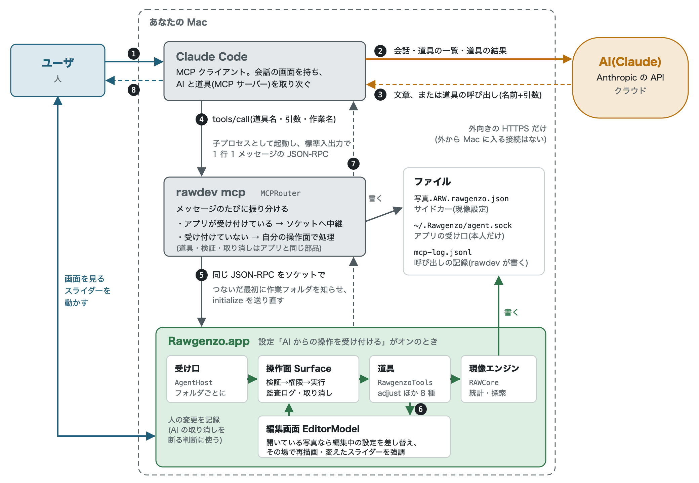
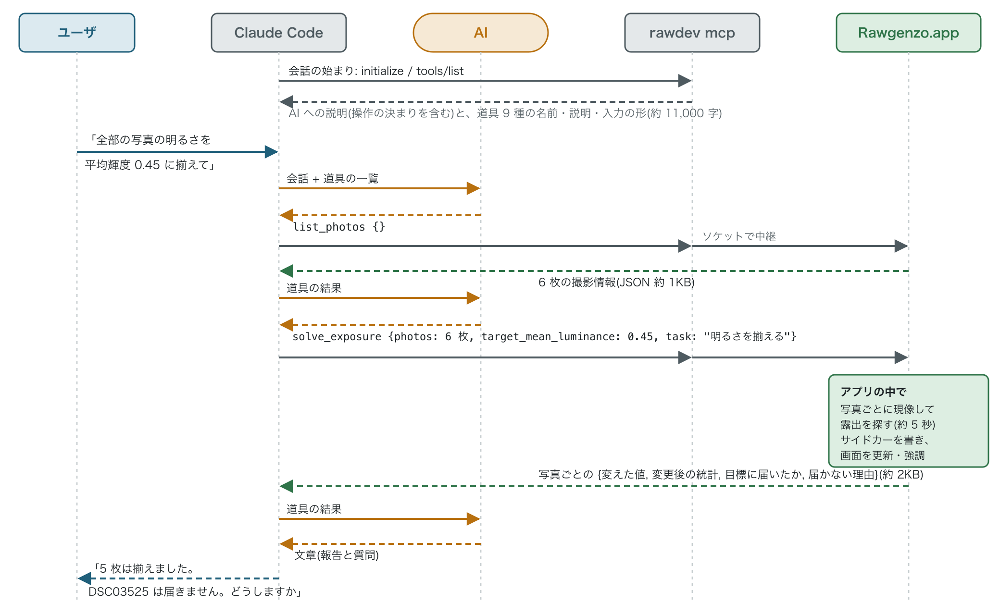

# AI が Rawgenzo を操作するときの、プロセスと通信

2026-10-16 時点の実装(main `2e553ca`)の説明。誰が、どのプロセスで、どちら向きに、何を伝えているかをまとめる。
検討の経緯と、実装前の考え方は [ai-agent-architecture.md](ai-agent-architecture.md) にある。

## 登場人物

| 登場人物 | 実体 | 役割 |
|---|---|---|
| ユーザ | 人 | AI に頼む。質問に答える。アプリの画面を見て、自分でもスライダーを動かす |
| AI | Claude(Anthropic の API の上で動く。クラウド) | 頼まれたことを、道具の呼び出しに分けて考える。Mac には直接触れない |
| Claude Code | MCP クライアント(Mac のプロセス) | 会話の画面を持ち、AI と道具(MCP サーバー)を取り次ぐ。AI が求めた道具の呼び出しを実際に行う |
| rawdev mcp | MCP サーバー(Claude Code の子プロセス) | 道具の呼び出しを、起動中の Rawgenzo アプリに中継するか、自分で処理する(`MCPRouter`) |
| Rawgenzo.app | アプリ(Mac のプロセス) | 設定「AI からの操作を受け付ける」がオンのとき、ソケットで呼び出しを受け、編集中の写真に反映する |

## 全体の配置と通信の向き

通信はすべて Mac の中か、Mac から外へ向かうもの(Claude Code → Anthropic の API の HTTPS)だけ。
外から Mac に入ってくる接続は無いので、ルーターの設定は要らない。

[](images/ai-mcp-overview.svg)

実線は依頼の向き、破線は返事の向き。色は登場人物ごと(人=青、AI=琥珀、中継するプログラム=灰、Rawgenzo=緑)。

1. ユーザが Claude Code に頼む(例「全部の写真の明るさを揃えて」)
2. Claude Code が、会話と道具の一覧を AI に送る
3. AI が「この道具をこの引数で呼んで」と返す
4. Claude Code が rawdev mcp に道具の呼び出しを送る
5. rawdev がアプリへ中継する。アプリが受け付けていなければ、rawdev が自分の操作面で処理してサイドカーを書く
6. アプリが検証・権限・実行。現像エンジンで統計を取り、サイドカーを書き、開いている写真なら画面を更新する
7. 結果(JSON の文字、縮小画像)が逆の道をたどって AI に届く。AI は必要なら 3 に戻る
8. AI の返事(結果の報告、判断が要る点の質問)が、Claude Code の画面でユーザに届く

## 1 つの指示の流れ(明るさを揃える)

会話の始まりに、Claude Code は rawdev mcp から AI への説明と道具の一覧を一度だけ受け取る。
以後は 3〜7 を、AI が必要とするだけ繰り返す。下は 2026-10-16 の試験の流れを簡略にしたもの。

[](images/ai-mcp-sequence.svg)

## 区間ごとの通信の中身

| 区間 | 方式 | 行き(依頼) | 帰り(返事) |
|---|---|---|---|
| ユーザ ⇄ Claude Code | 会話の画面 | 自然文の指示、質問への答え(「3 を選ぶ」など) | 結果の報告、判断が要る点の質問 |
| Claude Code ⇄ AI | 外向きの HTTPS(Anthropic の API) | 会話の履歴、AI への説明、道具の一覧(Claude Code の中では `mcp__rawgenzo__adjust` のような名前になる)、道具の結果(JSON の文字と画像) | 文章、または道具の呼び出し(道具名と引数)。呼び出しを実行するのは Claude Code で、AI は Mac に触れない |
| Claude Code ⇄ rawdev mcp | 子プロセスの標準入出力。1 行 1 メッセージの JSON-RPC 2.0(MCP) | `initialize`(クライアントの名前)、`tools/list`、`tools/call`(道具名・引数・作業名 `task`) | AI への説明、道具の記述(入力の形・影響の段階)、道具の結果(文字は JSON、画像は base64 の JPEG)、失敗の理由 |
| rawdev mcp ⇄ Rawgenzo.app | Unix ソケット `~/.Rawgenzo/agent.sock`(本人だけが読み書きできる)。中身は上と同じ JSON-RPC | 最初に `rawgenzo/workspace`(作業フォルダ)、続いて `initialize` の送り直し、以後は届いたメッセージをそのまま | アプリの操作面の返事をそのまま。途中で切れたら、rawdev が「変更が当たったか分からない」と返す |
| アプリの中 | 操作面のキュー ⇄ メインスレッド | 開いている写真の編集中の設定を読む・差し替える(AI の変更) | 人が変えて保存した写真を記録する(AI の取り消しを断る判断に使う) |
| Rawgenzo ⇄ ファイル | サイドカー `写真.ARW.rawgenzo.json` | 道具が現像設定を書く(アプリが居ればアプリが、居なければ rawdev が) | 道具が今の設定を読む(アプリで開いていれば編集中の値を優先) |

## 通信と変更を安全にしている仕組み

**つながり方**
- 外から Mac に入る接続は無い
- アプリの受け付けは設定で切り替え、既定はオフ。ソケットは本人だけが読み書きできる(0600)。アプリの終了時に消す
- rawdev はメッセージのたびにアプリを探す(`MCPRouter`)。会話の途中でアプリを起動・終了しても切り替わる。
  アプリに切り替えたときは `initialize` を送り直し、アプリの側でも誰の操作か分かるようにする。
  要求を送った後で接続が切れたら、その要求は失敗として返す(自分で処理し直すと二重に当たるおそれがある)

**AI に許すこと**
- 道具ごとに影響の段階(読むだけ・案を作るだけ・取り消せる変更・ファイルを書く・消す)を持つ
- AI には、読む・取り消せる変更を許す。ファイルを書く道具は人の確認が要る(今は該当する道具が無い)。消す道具は一覧にも出さない
- 入力は実行前に形と範囲を検証し、外れたら場所(`$.edits[0].changes.exposure` など)と理由を返す

**取り消し**
- 作業名(`task`)でまとめて戻す。人や他の AI の変更は取り消さない
- 履歴による確認: 後から別の主体(アプリでの人の変更の記録を含む)が同じ写真を変えていたら断る
- 状態による確認: 戻す項目が今も変更直後の値のままか、今の設定(編集中の値かサイドカー)で確かめ、違えば断る。
  戻すのは、その変更で変えた項目だけ。履歴はアプリと rawdev とで別々なので、状態での確認が要る
  (最初の版はこれが無く、切り替えをまたいだ取り消しが人の変更を消した)

## 図の直し方

図の元は `docs/images/*.svg`(手で編集する)。文書には PNG を貼っている(SVG のままだと、見る環境によって
日本語の書体や表示が変わるため)。SVG を直したら、librsvg の `rsvg-convert` で 2 倍の PNG を作り直す
(Homebrew の `librsvg`。日本語は macOS のヒラギノで描かれる):

```sh
rsvg-convert --zoom=2 -o docs/images/ai-mcp-overview.png docs/images/ai-mcp-overview.svg
rsvg-convert --zoom=2 -o docs/images/ai-mcp-sequence.png docs/images/ai-mcp-sequence.svg
```

`rsvg-convert` が無い環境では、次善の策として `scripts/svg2png.swift`(macOS の WebKit で描く。追加のインストールは要らない)を使う。
太字の太さなど、rsvg-convert とは少し見た目が違う:

```sh
swiftc -O -o /tmp/svg2png scripts/svg2png.swift
/tmp/svg2png docs/images/ai-mcp-overview.svg docs/images/ai-mcp-overview.png
```

## 主なソース

| 場所 | 内容 |
|---|---|
| `Sources/OperationSurface/` | 汎用の部分(Rawgenzo に依存しない)。`Surface`、`MCPServer`、`MCPRouter`、`UnixSocket` |
| `Sources/RawgenzoSurface/` | Rawgenzo の道具(`RawgenzoTools`)、作業場所(`RawgenzoWorkspace`)、アプリの受け口(`RawgenzoAgentHost`) |
| `Sources/rawdev/main.swift` | `rawdev mcp`(振り分けと記録) |
| `Sources/RawgenzoApp/AgentLink.swift`、`EditorModel.swift` | アプリの編集中の写真への反映、人の変更の記録、画面の知らせと強調 |

## 確かめていないこと

- Claude Code が、MCP から受け取った AI への説明と道具の一覧を、AI との会話にどう組み込むか(Claude Code 側の実装)
- 字数・時間は 2026-10-16 の試験での値。写真の枚数や大きさで変わる
