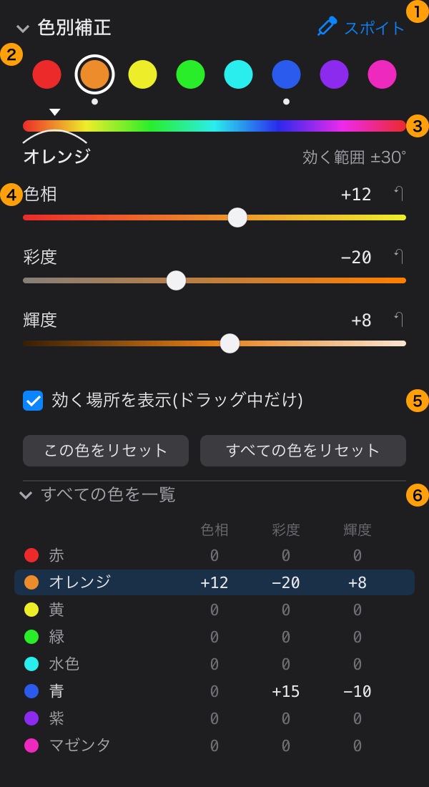
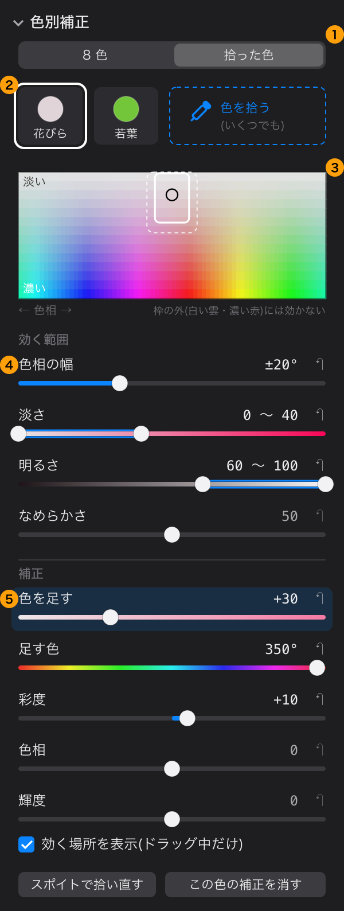
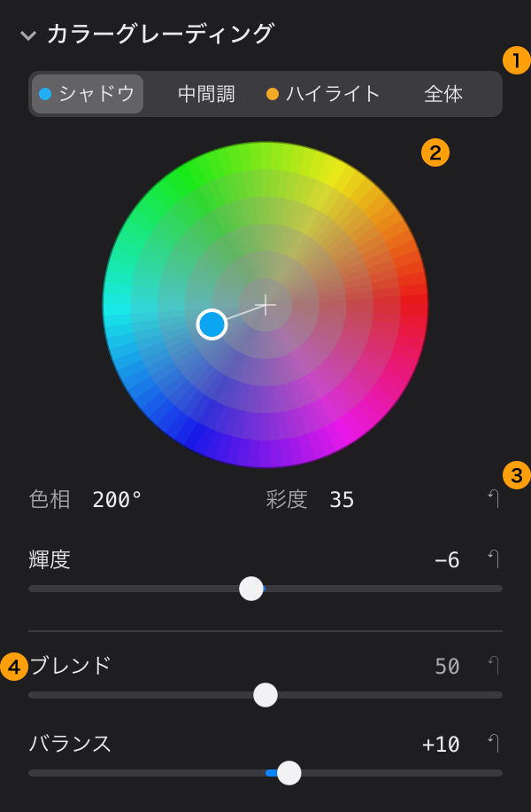

# 色の詳細補正 — 機能の規定と画面設計(検討)

2026-10-30 にオーナーの依頼で検討した。**実装はまだしていない**。この文書は、作る機能の範囲を決め、
画面の設計となんちゃってのモックを示すためのもの。オーナーが判断した点は「決めること」に追記していく。

同じ日に、オーナーの「桜の花びらだけピンク味を強くしたい」という例を受けて、A に「拾った色」の補正を足した
(8 色の帯だけでは、白に近い淡い色に効かず、同じ色相の濃い色まで変わってしまうため)。

## 依頼

> 色彩をより詳細に編集する UI を追加したい。Lightroom のカラーグレーディングや、SILKYPIX のファインカラーコントローラーのように、
> 特定の色を補正するような機能を追加する。

## 2 つの別の機能に分ける

例に挙がった 2 つは、同じ「色の補正」でも対象の選び方が違う。混ぜると画面も設定も分かりにくくなるので、別の機能として規定する。

| | A. 色別補正 | B. カラーグレーディング |
|---|---|---|
| 何を選んで補正するか | **色**(赤い所・空の青い所など) | **明るさの帯**(シャドウ・中間調・ハイライト) |
| 何を変えるか | その色の色相・彩度・輝度。拾った色では、淡い色に色を足すこともできる | その帯に色を足す(色かぶりを付ける) |
| 近いもの | Lightroom の「HSL / カラー」、SILKYPIX のファインカラーコントローラー | Lightroom の「カラーグレーディング」(旧「明暗別色補正」) |
| 使い道の例 | 空の青を深く、肌のオレンジを落ち着かせる、葉の黄緑を緑に寄せる、桜の花びらだけピンク味を強く | 暗部を青緑・明部を暖色にして映画風にする |

依頼の文の「特定の色を補正する」は A に当たる。**A を先に作り、B は次の段階**にすることを勧める。
B は、今あるルック(シネマ風など)と役割が一部重なるため、急ぐ理由が小さい。

## A. 色別補正

色の選び方を 2 つ持ち、セクションの上の切り替え(「8 色 | 拾った色」)で選ぶ。2 つは同時に効く(8 色の補正の後に、拾った色の補正)。

| | A-1. 8 色 | A-2. 拾った色 |
|---|---|---|
| 色の選び方 | 決まった 8 色の帯 | スポイトで拾った色を中心に、色相の幅と淡さの範囲で決める |
| 向いている補正 | 空・肌・植物など、色の帯全体の調子を整える | 桜の花びら・薄曇りの空など、**淡い色だけ**を狙う。同じ色相の濃い物は変えない |
| 変える値 | 色相・彩度・輝度 | 色を足す・彩度・色相・輝度 |

モックは今の調整パネルと同じ幅 300pt で描いた(番号はモック上の注記で、実際の画面には出ない)。

### A-1. 8 色



#### 規定する機能

1. **色は 8 つに分ける**: 赤・オレンジ・黄・緑・水色・青・紫・マゼンタ(モックの ②)。Lightroom と同じ分け方で、
   空・肌・植物など写真でよく直したい色がそれぞれ 1 つの帯に入る
2. **色ごとに 3 つの値**(④): 色相(−100〜+100。隣の色の方へずらす。最大で ±30° 程度)、
   彩度(−100〜+100。−100 でその色だけ灰色)、輝度(−100〜+100。その色だけ明るく・暗く)
3. **色の境目でなだらかに効かせる**(③): 選んだ色の中心から隣の色の中心まで、効き方を滑らかに弱める。
   境目で色が割れたり、グラデーションに段が出たりしないことを必須とする。色相の帯の上に、効く範囲を山の形で示す
4. **灰色に近い色には効かせない**: 彩度の低い画素(白・黒・灰色)は色相が定まらないので、元の彩度に応じて効き方を弱める。
   そのため淡い色(桜の花びらなど)にはほとんど効かない。淡い色は A-2 の拾った色で扱う
5. **スポイト**(①): プレビューの上の画素を押すと、その画素の色に一番近い色のチップを選ぶ。
   押したまま上下にドラッグすると、その色の**彩度**を変える。option キーを押しながらなら**色相**、shift キーなら**輝度**
   (Lightroom の「ターゲット調整」に相当。3 本のスライダーが同時に見えている画面なので、どれを動かすかを修飾キーで決める)
6. **効く場所を表示**(⑤): スライダーを動かしている間だけ、効く画素以外をプレビューで灰色にする。
   どこが変わるのかを確かめるため。既定はオン
7. **リセット**: 値ごと(各スライダーの ↶)、色ごと(この色をリセット)、全部(すべての色をリセット)
8. **すべての色を一覧**(⑥): 8 色 × 3 つの値を表で見る(折りたたみ。既定は閉じる)。どの色をいじったかを一目で見るため。
   チップの下の点も「値を変えた色」の印

#### 画面の設計

- 調整パネルの「色」(彩度・自然な彩度)の下に、新しいセクション「色別補正」を置く(既定は折りたたみ)
- 300pt の幅に 8 色 × 3 つのスライダー(24 本)を並べると縦に長すぎるので、**色を 1 つ選んで、その色の 3 本だけを見せる**
  (SILKYPIX のファインカラーコントローラーに近い形)。全体の確認は一覧の表で行う
- スライダーの溝を、その値で変わる先の色で塗る(色相なら隣の色へのグラデーション)。数字より先に向きが分かるようにするため。
  今の AdjustSlider(見出し・等幅の値・↶)の並びはそのまま使う
- スポイトは、プレビューを「色を拾う」状態に切り替えて使う。クロップ枠の調整中と同じく、その間は拡大表示を止める
  (`isCropping` と同じ扱い)。カーソルの形を変え、Esc かもう一度ボタンで抜ける

### A-2. 拾った色



#### 規定する機能

1. **切り替え**(①): 「拾った色」にすると、この画面になる
2. **拾った色の一覧**(②): 1 枚の写真にいくつでも(数の制限なし。多いときは一覧を横に送る)。「色を拾う」を押してプレビューの画素を押すと、その画素のまわり
   (数ピクセル四方の平均)の色を中心にした補正が 1 つ増える。名前は既定で「1」「2」…、変えられる(モックの「花びら」「若葉」)
3. **効く範囲の図**(③): 横が色相、縦が淡さ(上が淡い・下が濃い)。拾った色を真ん中に置き、効く範囲を枠で、
   なめらかに弱まる所を点線で示す。枠の角をドラッグして範囲を変えられる(下のスライダーと同じ値)
4. **効く範囲の値**(④):
   - 色相の幅(±5〜±60°。既定 ±20°)
   - 淡さ(0〜100 の範囲。つまみ 2 つ。既定は拾った色の淡さ ±20)。白い雲(色相が違う)や濃い赤(淡さが違う)を外せる
   - 明るさ(0〜100 の範囲。つまみ 2 つ。既定は拾った色の明るさ ±25)。明るい花びらを狙うとき、同じ色相・淡さの暗い枝を外す
     (最初は「今回は持たない」としたが、桜のサンプル DSC01032 で枝が紫がかったので足した。2026-10-30)
   - なめらかさ(0〜100。範囲の端で効き方を弱める幅。既定 50)
5. **補正の値**(⑤):
   - **色を足す**(0〜100): 足す色の色相の方へ、一定の量だけ色を足す。元の色の濃さを何倍にもする「彩度」と違い、
     ほとんど白の画素にも色が付く。淡い色を色づけるための値で、拾った色の補正の主役
   - **足す色**(色相 0〜360°): 初めは拾った色の色相。暖かい光で花びらが黄色みを帯びた写真(DSC01275)では、
     花びらを拾ってから足す色をピンクに変える(拾った色相のまま足すと黄色くなる。2026-10-30 に足した)
   - 彩度(−100〜+100)・色相(−100〜+100)・輝度(−100〜+100): 8 色と同じ意味
6. **効く場所を表示**・リセットは 8 色と同じ。「スポイトで拾い直す」は、範囲と補正の値を保ったまま中心の色だけを取り直す

#### 例: 桜の花びらだけピンク味を強くする

1. 「色別補正」を開き、「拾った色」に切り替えて「色を拾う」を押し、プレビューの花びらを押す
   (淡いピンクが拾われ、効く範囲が「花びらのまわりの色相・淡い側」に決まる)
2. 「色を足す」を上げる。ドラッグの間は「効く場所を表示」で、花びら以外が灰色になる
3. 空の白い雲や、濃い赤の物(提灯など)まで色づいていたら、図の枠か「淡さ」のつまみを動かして外す
4. 必要なら「色相」で、青みのピンク・赤みのピンクを好みに寄せる

8 色の「マゼンタ」の彩度を上げるやり方では、花びらがほとんど変わらず、同じ色相の濃い物だけが濃くなる(8 色の 4 の決まりのため)。

#### 桜のサンプルで試した結果(2026-10-30)

| 写真 | 花びら(前 → 後の濃さ) | まわり |
|---|---|---|
| DSC01032(青空の枝) | 2〜7 → 8〜22(ピンク) | 空・暗い枝は変わらない(色相の幅 ±30°、淡さ 0〜14、明るさ 60〜100 に絞ったとき。±50° では空が紫寄りになった) |
| DSC01275(花瓶・室内) | 黄色みの白 → ピンク(足す色 355°) | 後ろの壁も少し色づく。壁の一部は花びらとほぼ同じ色(濃さ 6.7・色相 90°・明るさ 0.62 と、花びら 5〜6・101°・0.73)なので、色で選ぶ補正では分けられない。分けるにはマスク(範囲の外) |

範囲の値は、アプリでは「効く場所を表示」を見ながら決める。試しでは値を私が手で決めた。

オーナーの評価(2026-10-30): DSC01032 は「かなり良い方向に補正されている」。DSC01275 のように背景が被写体と同じ色の写真は、
色で選ぶ補正ではやりきれず、画面の特定の領域だけを補正する機能(マスク)が要る。ただし画面が込み合うので、
**マスクは今は作らない**(オーナーの判断)。

## B. カラーグレーディング



### 規定する機能

1. **帯は 4 つ**: シャドウ・中間調・ハイライト・全体(①)。帯ごとに、足す色の色相(0〜360°)と強さ(彩度 0〜100)、
   その帯の明るさ(輝度 −100〜+100)
2. **色相環で選ぶ**(②): 中心が「色を足さない」、外周ほど強い。つまみをドラッグして色相と強さを同時に決める。
   細かい値は下の数字(③)で確かめ、直接打ち込めるようにする
3. **ブレンド**(④、0〜100): 帯どうしの境目の重なり。大きいほど 3 つの帯がなだらかに混ざる
4. **バランス**(④、−100〜+100): シャドウとハイライトの境目の明るさを動かす。+ でハイライト側の色が広く効く
5. **明るさを保つ**: 色を足しても、画素の明るさ(輝度)はできるだけ変えない。明るさは輝度のスライダーだけで変える

### 画面の設計

- 300pt の幅に色相環を 3 つ並べると、1 つ 90pt ほどになって操作しにくい。**大きな色相環を 1 つ置き、上の切り替えで帯を選ぶ**
- 切り替えのボタンに、その帯で足している色を小さな点で示す(モックではシャドウに青緑、ハイライトに橙)。
  3 つの帯の関係が、切り替えなくても分かるようにするため
- セクション「カラーグレーディング」は「色別補正」の下、「ディテール」の前に置く

## 処理の位置と作り方(実装の見通し)

- **処理の順番**: 今の色の段(ColorStage: 自然な彩度 → 彩度)の後に、A-1(8 色)→ A-2(拾った色。一覧の順)→ B の順で置く。
  クロップ・ルックより前(ルックはこれらの結果の上に掛かる)。CLAUDE.md の「クロップをルックより前」の順序は崩さない
- **作り方**: A も B も「1 つの色を受け取って 1 つの色を返す」計算なので、今のルック(`ColorCubeLook`)と同じく、
  設定から 3D LUT(色の対応表)をその場で作って Core Image の色キューブで当てられる。Metal のカーネルを新しく書かなくてよい。
  拾った色も「色相と淡さで決まる効き方 × 補正」なので、同じ 1 つの LUT にまとめられる
  - LUT は 33³ にした。作る時間はデバッグビルドで 33³ が 125ms、64³ が 916ms(スライダーを動かすたびに作り直すため)。
    未確認: 強い色相のずらしに段が出ないか(出るなら大きくする)
  - **確かめた**: 色キューブは 0〜1 の外の値を切る(入力 2.0・4.0 がどちらも 1.0 になった)。HDR 出力のとき、色別補正を
    使った写真だけ明るい所が 1 で切れる(ルックと同じ扱い)。使っていない写真はこの処理を通さないので変わらない
- **色の空間**: 色相・彩度・輝度の計算は、見た目に近い空間で行う(HSL をそのまま使うと、黄と青で同じ「輝度 +10」の見え方が大きく違う)。
  どの空間にするか(OKLCH など)は試作で決める

## 保存と互換性

- サイドカーに新しい項目を足すので、`schemaVersion` を 4 に上げ、古いサイドカーの読み込みテストを足す(CLAUDE.md の互換性の決まり)
  - A: 色の ID(`red` `orange` `yellow` `green` `aqua` `blue` `purple` `magenta`)ごとの {色相, 彩度, 輝度}。変えていない色は書かない
  - A-2: 拾った色の並び(数の制限なし。並びの順に当てる)。1 つずつ {名前, 中心の色(色相・淡さ・明るさ), 色相の幅, 淡さの範囲,
    明るさの範囲, なめらかさ, 色を足す, 足す色(無ければ拾った色相), 彩度, 色相, 輝度}。拾った画素の場所は保存しない(色だけ。写真を切り抜いても変わらないように)
  - B: 帯の ID(`shadows` `midtones` `highlights` `global`)ごとの {色相, 強さ, 輝度} と、ブレンド・バランス
  - これらの ID はファイルに書かれるので、決めたら変えない
- 調整パネルのセクションの ID も config.json に保存される(折りたたみ状態)。`hsl` と `grading` にする

## AI の道具

GUI の機能は AI からも使えるようにする方針(`docs/ai-tool-coverage.md`)なので、A・B にも道具を作る。

- 今の `adjust` の項目に 8 色 × 3 + 4 帯 × 3 + 2 の約 38 項目を足すと、会話のたびに送る道具の一覧が大きく増える
  (今は約 28 KB)。**色別補正とカラーグレーディングは、それぞれ専用の道具にする**(例: `adjust_colors` は色の ID で指定、
  `set_color_grading` は帯の ID で指定)
- `get_preview` で保存せずに試せるようにする(ルックの `look` と同じ)
- 拾った色は、AI がスポイトを使えないので、**画像の上の位置(get_preview の画像 = 切り抜いた後に対する比率)で色を拾う**。
  実装(2026-10-30): `set_color_point` に、変えたい所(at)と変えたくない所(exclude_at)の位置を渡すと、範囲は Rawgenzo が決め、
  強さは目標の濃さ(target_chroma)から探す。AI に範囲の値を試させない(明るさを揃える指示で値を試し続けた経験から、目標で指示させる)。
  外せない所は unresolved で返す。`get_preview` に `grid`(座標の目盛り)と `color_mask`(効く場所)を足した
- **気をつけること**: 今は数値パラメータの置き場が `ParameterCatalog` 1 つで、`adjust` の入力の形・調整パネルのスライダー・
  `rawdev params` / `rawdev develop` の範囲チェックがそこから作られる(テスト `testChangesSchemaFollowsCatalog` が `adjust` と
  カタログの一致を確かめている)。色別補正の値をカタログにそのまま足すと `adjust` に全部入ってしまう。
  カタログに「`adjust` には出さない」印を付けるか、色別補正の値は色の ID ごとの別の表(範囲・説明)に置くかを、実装の最初に決める
- 「空をもっと青く」のような指示に、AI がどの色を動かすか決められるよう、`get_stats` に色ごとの画素の割合を足すことも検討する

## 作らないもの(今回の範囲の外)

- マスク(範囲を指定して、その場所だけ補正する)。2026-10-30 にオーナーが「今は作らない」と判断(画面が込み合うため)
- トーンカーブ(RGB 別のカーブ)

## 決めること

| | 選択肢 | 勧め |
|---|---|---|
| 1 | 色の分け方: 8 色の帯で固定 / スポイトで拾った色を中心にした帯を自由に足せる | **決定(2026-10-30)**: 両方持つ。桜の花びらのような淡い色は 8 色では扱えないため(最初は「8 色で固定」を勧めていた) |
| 4 | 拾った色の数: 4 つまで / 制限なし | **決定(2026-10-30)**: 制限なし(最初は 4 つまでを勧めていた)。処理は数によらず 1 つの LUT にまとめる |
| 2 | 作る順番: A だけ先に / A と B を一緒に | **決定(2026-10-30)**: A を作る。B は、A をしばらく使って足りなければ作る(後回し) |
| 3 | AI の道具: 専用の道具 / `adjust` に項目を足す | **決定(2026-10-30)**: 専用の道具 |

SILKYPIX のファインカラーコントローラーの細かい動き(効く範囲を変えられるか、色の数など)は、記憶だけで書くと誤りそうなので、
この文書では「近い形」とだけ書いた。オーナーがふだん使っている操作と違う点があれば、それに合わせて直す。

## モックの直し方

モックの SVG(`docs/images/color-hsl-mock.svg`、`color-point-mock.svg`、`color-grading-mock.svg`)は `scripts/mock_color.py` が作る
(色相環は細かい扇形の集まりなので、SVG を手で直すのは現実的でない)。スクリプトを直して、次の手順で作り直す。

```sh
cd docs/images && python3 ../../scripts/mock_color.py .
rsvg-convert --zoom=2 -o color-hsl-mock.png color-hsl-mock.svg
rsvg-convert --zoom=2 -o color-point-mock.png color-point-mock.svg
rsvg-convert --zoom=2 -o color-grading-mock.png color-grading-mock.svg
```

モックは暗い表示で描いた。実際のアプリは macOS の外観(ライト / ダーク)に従う。
