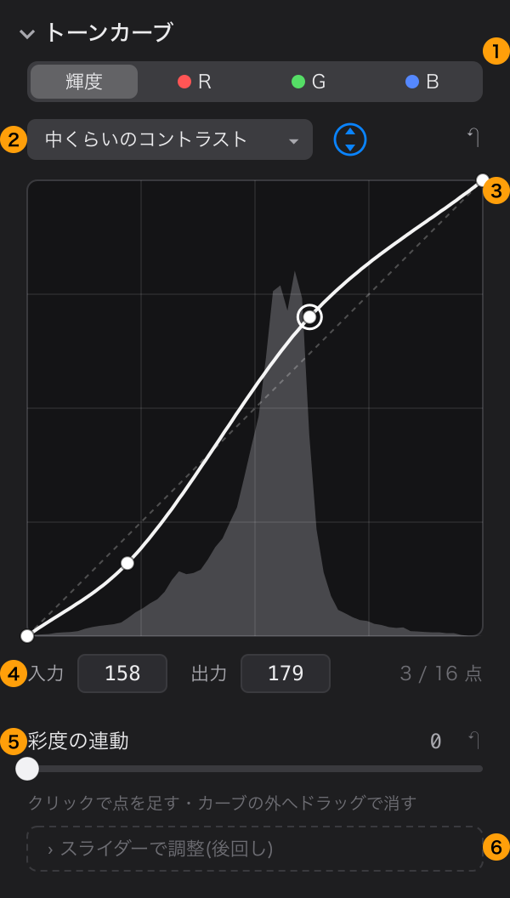
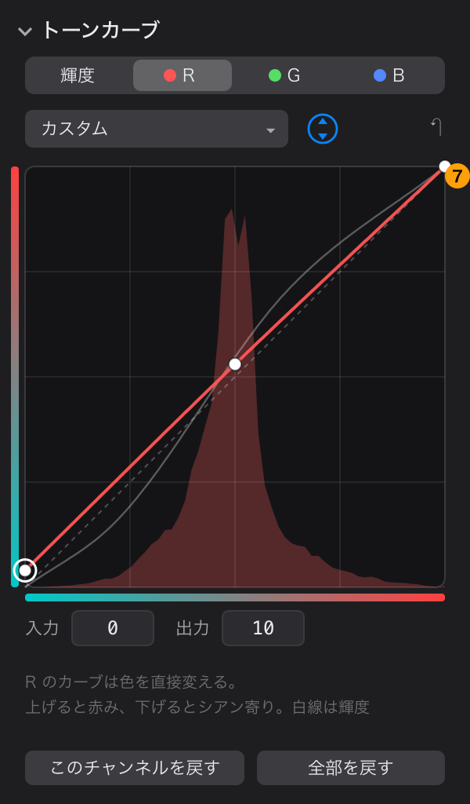

# トーンカーブの設計(案)

2026-10-30 作成。「決めること」の 1〜5 は、同じ日にオーナーがおすすめどおりに決めた。
**1 段目は 2026-10-30 に実装した**(tone-curve ブランチ。実装で変えた点は「5. 実装で決めたこと」)。

## 1. ほかのソフトの調べ

| ソフト | 主な機能 |
|---|---|
| Lightroom Classic | **パラメトリック**(ハイライト・ライト・ダーク・シャドウの 4 スライダーと、区切り位置の 3 つの三角)と **ポイントカーブ**(RGB 合成・R・G・B。点は最大 16 個、入力/出力の数値欄、矢印キーで微調整、カーブの外へドラッグで削除、グリッドへのスナップ、全チャンネルのカーブを重ねて表示、チャンネルごと・全部のリセット、プリセットの保存)。写真の上を上下にドラッグして直す **ターゲット調整ツール**(Esc で抜ける)。**彩度の調整**(Refine Saturation。既定 100、0 にするとポイントカーブが明るさだけに効く) |
| Capture One | **Luma カーブ**(彩度を変えない)と **RGB カーブ**(彩度も変わる)を分けて持つ。R・G・B 別のカーブもある |
| darktable | 補間の方法と、色の保ち方(Lab の分離・連動、XYZ 連動、RGB 連動。「色を保つ」)を選べる。写真から拾った値をグラフに示す |
| SILKYPIX | 調べが足りず未確認(オーナーは長く使っていたので、違いがあれば教えてほしい) |

出典:
- [The Tone Curve Panel in Lightroom Classic(Julieanne Kost)](https://jkost.com/blog/2024/08/the-tone-curve-panel-in-lightroom-classic-2.html)
- [Luma, not Luma(Capture One)](https://www.captureone.com/blog/luma-not-luma)
- [Difference between Luma Curve & RGB Curve(Capture One コミュニティ)](https://support.captureone.com/hc/ja-jp/community/posts/360009391758-Difference-between-Luma-Curve-amp-RGB-Curve)
- [tone curve(darktable 5.6 マニュアル)](https://docs.darktable.org/usermanual/5.6/en/module-reference/processing-modules/tone-curve/)

分かったこと:
- どのソフトも中心は**点を置くカーブ**。パラメトリックは Lightroom の「やさしい入口」
- 「カーブで色(彩度)が変わるか」の扱いが各社で分かれている。明るさだけに効く形(Capture One の Luma、Lightroom の彩度 0)と、
  R・G・B それぞれに当てる形(彩度も上がる)がある
- R・G・B 別のカーブは色を変える道具(クロスプロセス風など)として使われる

## 2. Rawgenzo で作るもの(提案)

### 1 段目(最初に作る)

1. **チャンネルの切り替え**: 輝度・R・G・B
2. **プリセット**: リニア(初期値)・弱い/中くらい/強いコントラスト。点を動かすと「カスタム」になる。保存する ID は変えない
   (`linear` `medium` `strong` など)
   - 右の丸い矢印は写真の上でドラッグして直す道具(**2 段目**。決めること 4)。↶ は輝度・R・G・B を全部戻す
3. **グラフ**: 正方形(パネルの幅いっぱい、約 268pt)。後ろにそのチャンネルのヒストグラム、4 分割の目盛り、斜めの点線(変えていない線)。
   クリックで点を足し、ドラッグで動かし、カーブの外へドラッグで消す。端の 2 点は上下だけ動く。選んだ点は丸で囲む。
   カーブは点を必ず通り、行き過ぎない(単調な 3 次補間。点の間で山や谷を作らない)
4. **入力・出力**: 選んだ点の値(0〜255)。数字で打てる。矢印キーで 1 ずつ(⇧ で 10)。点の数(最大 16)
5. **彩度の連動**(0〜100): 0 = 明るさだけ変えて色合いと彩度を保つ(今のコントラストのスライダーと同じ計算)、
   100 = R・G・B それぞれに同じカーブを当てる(S 字なら彩度も上がる。Lightroom の既定に近い)。初期値は決めること 2
6. **スライダーで調整(パラメトリック)**: 後回しの案(決めること 1)

7. **R・G・B のカーブ**: 軸にその色と補色のグラデーション、後ろにその色のヒストグラム、輝度のカーブを薄く重ねる。
   R・G・B のカーブは色を直接変える(彩度の連動とは関係なく、そのチャンネルに当てる)。「このチャンネルを戻す」「全部を戻す」

### 2 段目以降(候補)

- 写真の上でドラッグして直す道具(Lightroom のターゲット調整)。拾う値は**カーブを当てる前**の明るさ。
  色別補正のスポイトと同じ仕組み(`usesFitPreview`・プレビューの上の受け口)を使える
- パラメトリック(スライダー 4 本)
- 自分のプリセットの保存

### 今あるものとの関係

- **コントラストのスライダーは残す**。トーンカーブは ContrastStage の後(tone の段の最後)に当てる。
  スライダーで足りる人はカーブを触らなくてよい
- パラメトリックを後回しにする理由: 今のコントラスト・HDR のハイライト/シャドウと役目が重なり、同じことをする操作が 3 つになる
- R・G・B のカーブは、後回しにしたカラーグレーディング(B)と役目が一部重なる(明るさごとに色を寄せる)。
  先に作ると、B を作るときに「どちらで直すか」が増える(決めること 3)

## 3. 実装の見込み(メモ)

- **保存**: `DevelopSettings.toneCurve`(nil = 使わない)。チャンネルごとに点の並び(0...1 の組)と、彩度の連動、プリセットの ID。
  チャンネルの ID は `luma` `red` `green` `blue`(保存されるので変えない)。schemaVersion を 5 に上げ、古いサイドカーの読み込みテストを足す。
  `SettingsFields` に項目を足す(取り消し・ハイライトの対象)
- **計算**: ContrastStage と同じく Metal のカーネル(CIImageProcessorKernel)で、カーブを 1D の表(LUT)にして渡す。
  0〜1 の外の値は通す(HDR 出力で切らないため)。CIColorCurves は 1 を超える値を切るかもしれない(未確認)。
  輝度のカーブ: リニアの Y → ガンマ → カーブ → リニアに戻し、RGB を比で掛ける(ContrastStage と同じ)。
  彩度の連動はこの結果とチャンネルごとに当てた結果を混ぜる。比で掛けたときに色域の外へ出る場合の扱いは未確認
- 点は数値パラメータではないので `ParameterCatalog` には入れない(プリセットと彩度の連動だけ説明を足す)
- **AI の道具**: `set_tone_curve`(チャンネル・点・プリセット・彩度の連動)。目標の形(get_stats の分位点から
  「暗部を締めて中間を上げる」3 点のカーブを作る。solve_exposure と同じ考え)も候補(決めること 5)。
  道具の一覧は今 37,982 バイト。増やすのは 2 KB までを目安にする。`docs/ai-tool-coverage.md` も直す
- 手間: 中〜大(グラフの操作が一番大きい)。段に分けて進める

## 4. 決めたこと(2026-10-30、おすすめどおり)

| # | 内容 | 決定 |
|---|---|---|
| 1 | パラメトリック(スライダー 4 本)を最初から作るか | 後回し(今のスライダーと重なる) |
| 2 | 彩度の連動の初期値 | 0(今のコントラストと同じ振る舞い。色が変わらない) |
| 3 | R・G・B のカーブを入れるか(カラーグレーディング B と重なる) | 入れる(Lightroom の利用者が探す機能) |
| 4 | 写真の上でドラッグして直す道具を 1 段目に入れるか | 2 段目 |
| 5 | AI の目標の形の道具を最初から作るか | 点・プリセットの道具を先に、目標の形は試験の様子を見てから |

## 5. 実装で決めたこと(1 段目)

- **プリセットの ID は保存しない**。輝度の点の並びが決まった形と同じかで見分ける(点を動かせば「カスタム」)。
  ID(`linear` `weak` `medium` `strong`)は AI の道具の preset でだけ使う
- **ほぼ黒の所**: 黒を持ち上げるカーブで、輝度の比で掛けると、輝度の小さい色の画素が何倍にもなり(暗い青が鮮やかな青になる)、
  真っ黒の画素だけが黒く残る。見た目の明るさ 0.05 未満は、黒に近いほど R・G・B それぞれに掛ける側へ寄せる
  (`ToneCurveMath.blackBlend`。advisor と Fable の両方が指摘)
- **0〜1 の外**: カーブの端の接線で伸ばす(傾きの下限 0.2)。HDR 出力で 1 を超える明るさを切らず、折れ目も作らない
- **グラフの後ろのヒストグラム**: カーブを掛ける前の分布(カーブを外して長辺 512 で描いて数える。カーブ以外が変わったときだけ)。
  掛けた後の分布だと、ドラッグのたびに背景が動く
- 点の補間は単調な 3 次エルミート(Fritsch–Carlson)。GPU には 1 チャンネル 1024 の表で渡す
- 調整パネルの欄は HDR の後。初めから開いている(折りたたむかはオーナーの判断待ち)
- 道具の一覧は set_tone_curve で 1,996 バイト増えた(39,978 バイト)
